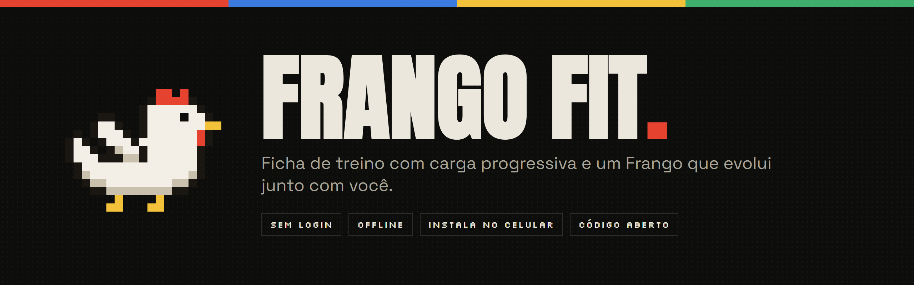
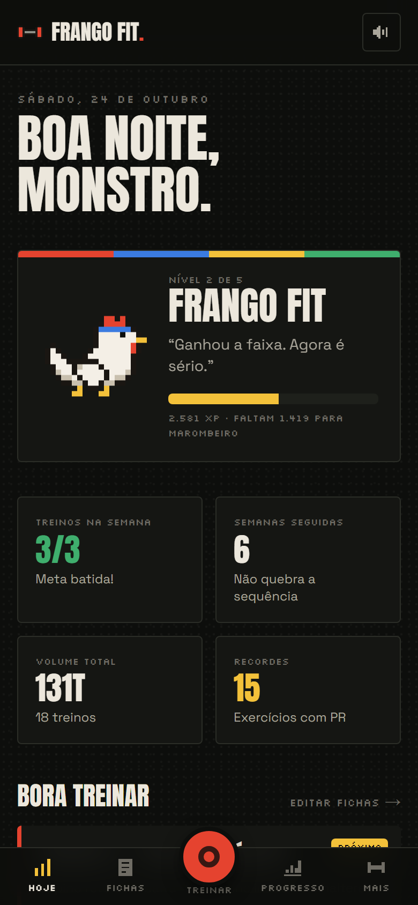
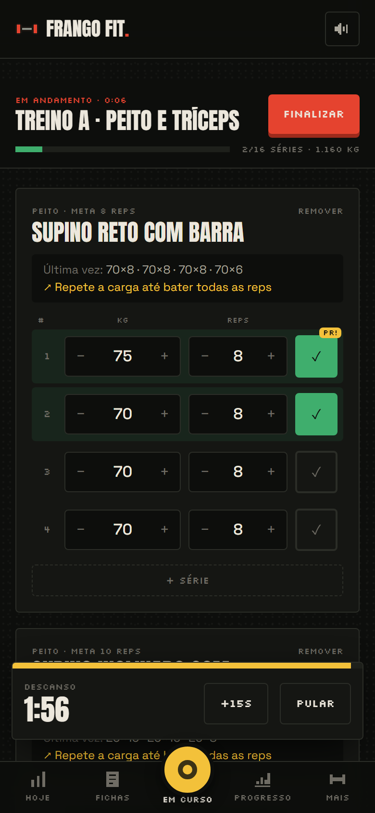
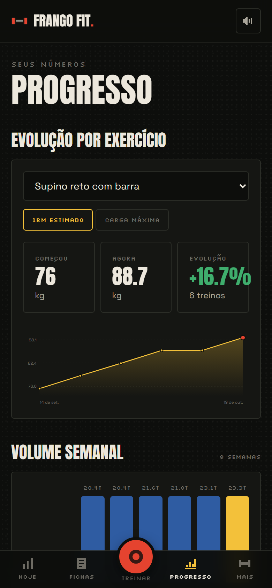
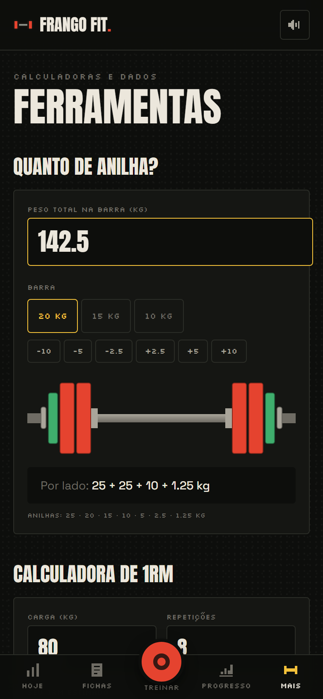
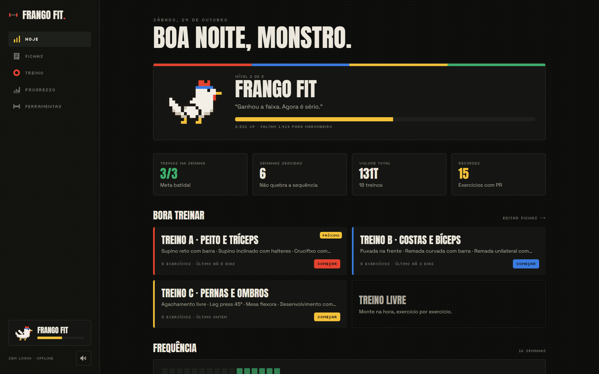
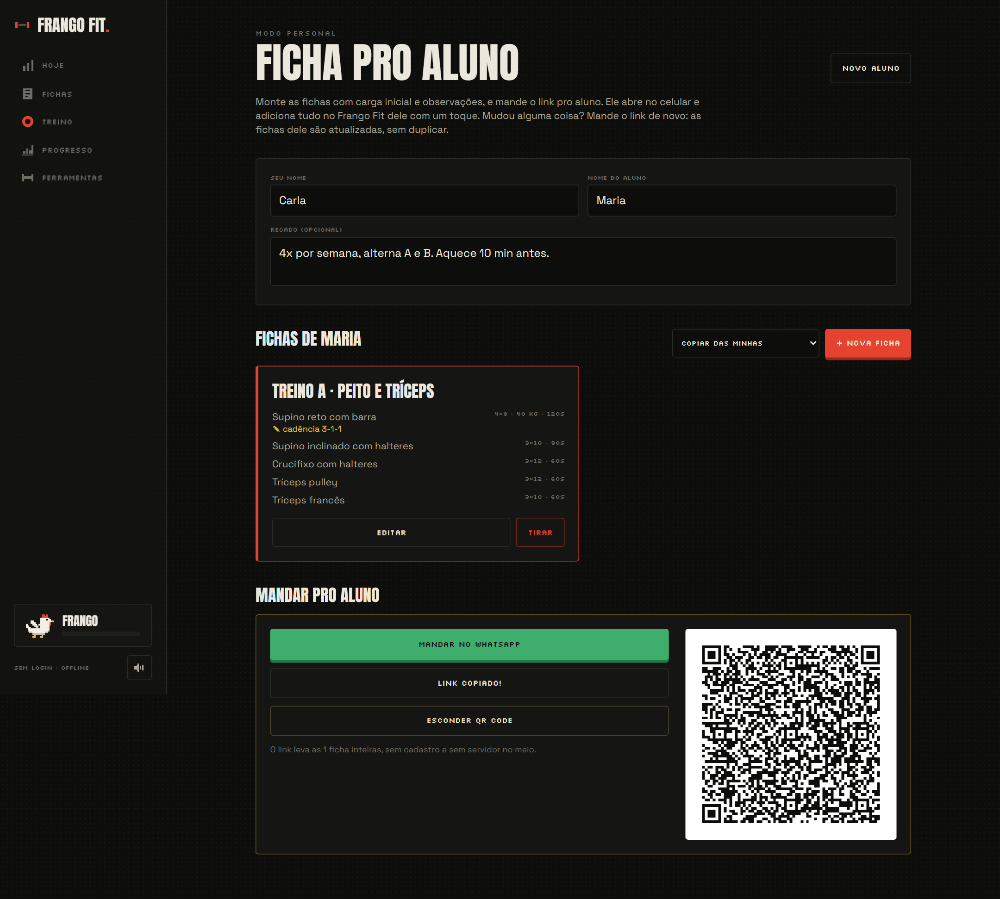
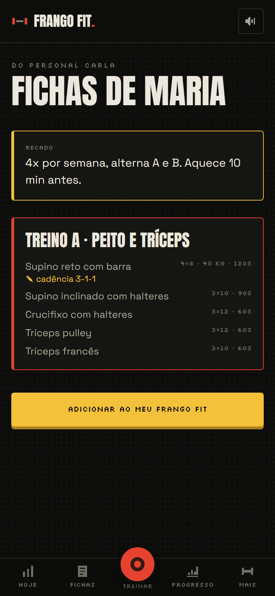

<div align="center">



<br />

[](https://frango-fit.joaovaz.dev)


**Feito para usar no celular, no meio da série.** Sem login, sem servidor, funciona offline e instala na tela inicial.

</div>

---

## 📱 Telas

<table>
  <tr>
    <td align="center"><br /><sub><b>Hoje</b><br />nível, metas e frequência</sub></td>
    <td align="center"><br /><sub><b>Treino</b><br />carga sugerida, PR e descanso</sub></td>
    <td align="center"><br /><sub><b>Progresso</b><br />evolução e volume</sub></td>
    <td align="center"><br /><sub><b>Ferramentas</b><br />anilhas e 1RM</sub></td>
  </tr>
</table>

<details>
<summary><b>Ver no desktop</b></summary>
<br />

</details>

## 🏋️ O que ele faz

| | |
| --- | --- |
| 📋 **Fichas de treino** | Monte treino A, B, C... com séries, repetições e descanso. **137 exercícios** em 9 grupos musculares, com filtro por equipamento, e dá para criar os seus. |
| 📈 **Carga progressiva** | Mostra o que você fez da última vez e já sugere o peso. Bateu todas as reps? Sobe. Não bateu? Repete até bater. |
| ⏱️ **Descanso automático** | O timer começa sozinho quando você marca a série, com som 8-bit e vibração no celular. |
| 🏆 **Recordes na hora** | Cada série é comparada com seu melhor 1RM estimado. Bateu? Aparece **PR!** ali mesmo. |
| 📊 **Progresso** | Evolução por exercício, volume semanal, mapa de frequência estilo GitHub e histórico completo. |
| 🐔 **O Frango evolui** | Sobe de nível com o seu volume, treinos e recordes, e ganha faixa, cores novas e até óculos escuros. |
| 🧮 **Ferramentas** | Calculadora de anilhas que monta a barra com as cores olímpicas, e calculadora de 1RM com tabela de porcentagens. |
| 🧑‍🏫 **Modo personal** | O personal monta as fichas do aluno com carga inicial e observações e manda por link, WhatsApp ou QR Code. O aluno adiciona com um toque, e um link novo atualiza as fichas sem duplicar. |
| 🔒 **Seus dados são seus** | Tudo fica no aparelho. Backup e importação em JSON quando quiser trocar de celular. |

### Os níveis do Frango

| Nível | XP | Visual |
| --- | --- | --- |
| Frango | 0 | o clássico, todo mundo começa aqui |
| Frango Fit | 1.000 | ganha a faixa azul |
| Marombeiro | 4.000 | faixa vermelha |
| Monstro | 12.000 | faixa dourada |
| Bambam | 30.000 | faixa dourada e óculos escuros |

> XP = volume levantado ÷ 100 + 50 por treino + 25 por exercício com recorde.

## 🧑‍🏫 Modo personal

<table>
  <tr>
    <td width="62%"></td>
    <td width="38%" align="center"></td>
  </tr>
</table>

Em **Fichas → Sou personal**, o personal monta as fichas (do zero ou copiando as dele), com carga inicial e uma observação por exercício, como "cadência 3-1-1". O plano inteiro vai compactado no próprio link, depois do `#`: não precisa de cadastro nem de servidor, e funciona até com o aluno escaneando o QR Code na academia. No primeiro treino, a carga do personal já vem preenchida e a observação aparece em cima do exercício.

## 🧠 Como a carga é sugerida

A regra é a da **dupla progressão**, simples e usada em academia de verdade:

1. O app procura a última vez que você fez aquele exercício.
2. Se **todas** as séries bateram as repetições da meta, sugere a carga mais alta daquele dia **+2,5 kg** (ou +2 kg / +1 kg em cargas leves).
3. Se alguma série ficou abaixo, sugere **repetir a carga** até bater tudo.

O recorde de cada exercício é o **1RM estimado** pela fórmula de Epley: `carga × (1 + reps / 30)`. Assim, 80 kg × 8 e 90 kg × 3 podem ser comparados na mesma régua.

Toda essa lógica está em [`src/lib/calc.ts`](src/lib/calc.ts), em funções puras e fáceis de testar.

## 🚀 Rodar localmente

```bash
git clone https://github.com/Bleachless/frango-fit.git
cd frango-fit
npm install
npm run dev
```

Abra http://localhost:3000. Em **Ferramentas → Carregar exemplo** você vê o app com 6 semanas de treino.

## 🗂️ Por dentro

```
src/
├── app/                 # telas: Hoje, Fichas, Treino, Progresso, Ferramentas, Personal e Aluno
├── components/          # shell, gráficos em SVG, barra de anilhas, pixel art
└── lib/
    ├── calc.ts          # volume, 1RM, recordes, sugestão de carga, níveis, anilhas
    ├── store.ts         # estado com zustand, salvo no localStorage
    ├── plan.ts          # ficha do personal no link: compactar, ler e juntar sem duplicar
    ├── exercises.ts     # biblioteca de exercícios
    ├── clock.ts         # relógio que não quebra a pré-renderização
    └── sfx.ts           # sons 8-bit gerados com Web Audio, sem arquivo de áudio
```

- **Next.js 16 + React 19** com todas as páginas estáticas: dá para hospedar de graça e abrir offline.
- **zustand** com persistência no navegador: zero servidor, zero cadastro.
- **Gráficos e pixel art feitos à mão em SVG**, sem biblioteca de gráficos.

## 🛣️ Próximos passos

- [ ] Conta opcional para sincronizar entre aparelhos
- [ ] Desafios semanais entre amigos
- [ ] Mais testes automatizados (o plano do personal já tem, em `plan.test.ts`)
- [ ] Exportar o treino como imagem para compartilhar

---

<div align="center">

Feito por **[João Vaz](https://github.com/Bleachless)**, que programa de dia e treina de noite.
<br />
O Frango também mora no meu portfólio. 🐔

</div>
